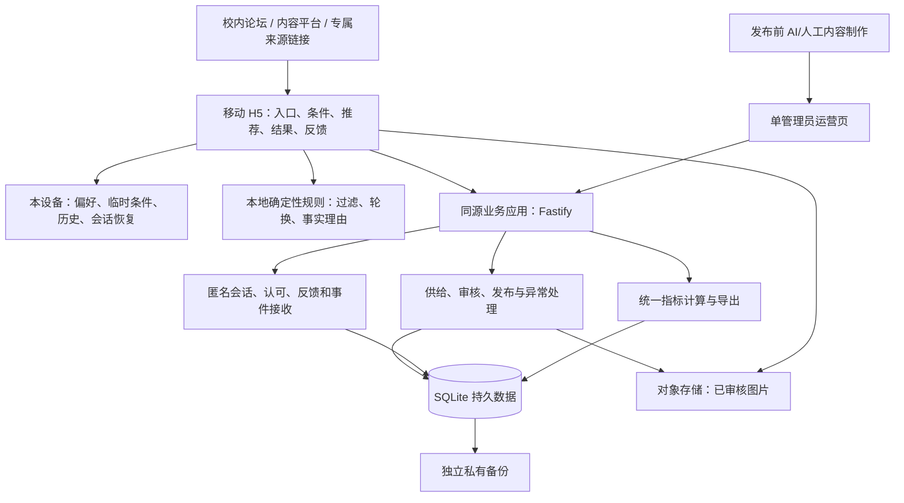

# 吃什么｜MVP 开发方案说明

版本：v1.0  
日期：2026 年 9 月 23 日  
文档定位：技术评估、技术选型与架构决策；供后续开发 Agent 阅读和实施。  
需求基线：[当前 PRD（轻量验证修订版）](D:/WTE/校园饭点辅助决策助手_PRD_MVP_v1.md)。  
辅助依据：[竞品与机会评估](D:/WTE/校园饭点辅助决策助手_竞品与机会评估_2026-09-22.md)。

本文确定做什么、由谁负责、为什么这样选、如何验收，以及何时需要升级。具体代码、接口路径、数据库建表语句、部署命令和模型提示词由开发阶段设计，不在本文展开。

## 1. 推荐结论

采用 **移动端 H5 + TypeScript 模块化单体 + SQLite + 轻量运营管理页**。

推荐组合：

- 用户界面：React、Vite、TypeScript，使用 CSS 变量和 CSS Modules 落实 PRD 的视觉风格。
- 服务端：Node.js 当前受支持的 LTS、Fastify，统一承担供给管理、匿名会话、反馈、事件记录和导出。
- 数据：SQLite 与 Drizzle；单实例运行，数据库保存在持久磁盘。
- 图片：对象存储；真实图片与 AI 示意图统一管理，保留来源、类型与审核状态。
- AI：发布前制作并审核图片和文案；本顿理由由已核实事实与当前条件组合，在线决策不依赖模型。
- 部署：一台 Linux 轻量云主机，Docker Compose 与 Caddy；同源提供网页和服务，独立对象存储保存图片及异地备份。
- 验证：站内最小事件记录、可选反馈与 CSV 汇总导出；推广曝光等平台数据人工补充。

这是基于当前单校园、30–60 个候选、单人维护及自然流量验证的推荐，不是所有规模下的通用最优方案。前期节省的重点是部署单元、模型调用和重复维护；规则、数据口径、备份与运营能力不能省略。

## 2. 评估前提与约束

### 2.1 规模假设

| 项目 | 本方案的规划假设 |
|---|---|
| 维护者 | 1 名项目负责人，由开发 Agent 辅助实现 |
| 产品范围 | 1 个校园、1–2 个主要出发区域、30–60 个菜品/套餐 |
| 访问环境 | 中国大陆校园网络、移动网络、微信内置浏览器及常见手机浏览器 |
| 首期负载 | 按 100–500 日活、短时约 20 个并发请求准备与验证；不是已测容量 |
| 管理用户 | 1 个运营管理员；普通用户不注册 |
| 发布节奏 | 小批迭代，首轮观察约 14 天；保留 7 天反馈和复用统计能力 |
| 已有技术资产 | 当前工作区仅有产品文档，未发现需兼容的已有应用 |
| 业务限制 | 不接支付配送、不做公开社区、无跨设备账户同步要求 |

实际流量超过假设不代表马上换架构，应先检查图片带宽、事件写入、慢查询和资源使用。不能以“初期用户少”为理由交付没有真实存储和反馈的静态演示。

### 2.2 需求优先级

发生冲突时依次遵循：

1. 用户最新要求及当前 PRD；
2. 当前 PRD 的轻量验证与指标口径；
3. 本文的技术选择和边界；
4. 较早概念设计与竞品评估中的建议。

竞品评估中较早的问卷、人工对照建议不作为开发要求。保留用户对“有吸引力的图片优先、允许 AI 制图”的修改，实际采用示意图时继续执行当前 PRD 的标注要求。

### 2.3 四个架构目标

- **完整验证：** 从来源访问到真实选饭、认可、餐后反馈、跨日复用均能被记录。
- **运行便宜：** 常见选饭操作无需模型调用，无需多个后端服务。
- **容易修：** 菜品、价格、营业和图片可由运营直接更新，不改代码、不重新发布前端。
- **能够长大：** 校园、数据存储、模型与地图各自有边界，后续扩展不重写全部产品。

## 3. 技术选型与取舍

### 3.1 整体方案比较

| 方案 | 当前收益 | 主要代价 | 结论 |
|---|---|---|---|
| 纯静态网页 + 本地数据 | 开发最少、部署简单 | 无法集中收集真实反馈；供给停用和指标口径难以可靠维护 | 可做演示，不能作为完整 MVP |
| React H5 + 轻量单体 + SQLite | 单语言、部署少、关系数据与导出直接；可自行控制区域和成本 | 需承担基础运维、备份；单机有可用性上限 | **本期采用** |
| Next.js + PostgreSQL/BaaS | 一体化开发，认证与托管能力丰富，后续扩展方便 | 当前 SEO/SSR 和用户账号需求弱；多项托管资源与访问链路需评估 | 可行备选，当前不增加这部分复杂度 |
| 国内托管云开发/Serverless | 减少服务器日常维护，弹性较方便 | 套餐、调用与出站费用、冷启动、数据模型和平台绑定需确认 | 已有成熟资源或无法承担主机维护时再选 |
| 小程序优先 | 平台入口与回访路径更直接 | 增加平台审核、发布与生态依赖，公域访问有跳转成本 | 保留为后续客户端 |
| 微服务 + 独立推荐/AI 平台 | 适合多团队和较大规模 | 部署、监控、数据一致性和联调成本明显超出本期收益 | 本期不采用 |

选择 H5 不意味着永远不用小程序；选择 SQLite 也不意味着未来无需 PostgreSQL。本期先让完整闭环与验证数据成立。

### 3.2 推荐技术清单

| 层次 | 推荐 | 选择理由与使用边界 |
|---|---|---|
| 页面框架 | React + Vite + TypeScript | 移动交互生态成熟；静态构建适合论坛直接打开；服务端不承担无必要的页面渲染 |
| 样式 | CSS 变量 + CSS Modules | 能直接控制暖色、卡片和按钮层级；少量页面不必引入大型设计系统 |
| 页面状态 | React 自带状态机制 + 明确的状态转换模型 | 状态复杂度来自业务，不需要全局状态框架；规则独立于组件 |
| 服务端数据读取 | TanStack Query | 统一加载、刷新、错误和缓存状态；不能用缓存掩盖供给过期 |
| 服务端框架 | Fastify + TypeScript | 轻量常规 Web 服务，支持模块拆分、校验与管理鉴权；前后端共享业务类型 |
| 契约校验 | Zod | 约束运营输入、反馈与事件格式，避免多个 Agent 各写一套枚举 |
| 数据访问 | Drizzle + SQLite | 迁移和查询可版本化，日后更换数据库有明确边界；ORM 不意味着零成本迁移 |
| 浏览器持久化 | 小规模偏好用本地存储；待发送事件用 IndexedDB | 偏好不必上云；允许短时网络中断后补传，不把整个产品做成离线应用 |
| 图片/备份 | 阿里云 OSS，图片与私有备份隔离 | 图片不占主机主要出口；同一云减少账号和账单数量 |
| 服务部署 | Linux 轻量主机 + Docker Compose + Caddy | 一套发布与回滚流程；证书和反向代理集中管理 |
| 验证工具 | Vitest + Playwright，辅以真机检查 | 核心规则、数据口径和完整流程可回归；微信实际表现仍需真机 |
| 报表 | 服务端统一计算 + CSV 导出 | 直接支持两周复盘，不单独建设 BI 平台 |

运行时与依赖采用开发时仍受支持的稳定版本，建立锁定记录，避免不同 Agent 各自选择“最新版”。不在本文给出未经核验的精确版本或云厂商实时报价。

### 3.3 部署区域选择

**生产默认：中国内地区域的轻量主机及同地域对象存储。** 若已有可复用资源，优先复用；否则以阿里云作为默认采购候选，不在代码中绑定其专有业务数据能力。

正式选区域时，在目标校园网络和手机移动网络检查页面与图片访问。中国内地公开网站所需的域名备案等手续属于上线依赖，不应在开发完成后才发现。

若尚未具备对应上线条件，可先以香港地域部署验证版；上线前同样测试校园可达性、延迟和平台内跳转，不承诺所有学校都能稳定访问。数据库、应用和媒体尽量就近，不能把主链路拆到多个远距离区域。

本期不默认采用境外托管前端再跨区域调用国内后端。具体地区最终由可用资源、校园实测与正式发布条件决定，业务架构保持一致。

## 4. 总体架构

采用“单仓库、前后端分模块、生产一个业务应用”的结构。构建工具不等于线上运行服务，浏览器界面和后端职责仍需分清。

推荐规则先在浏览器中运行，原因是候选少、即时换卡有价值、敏感偏好无需发送到分析系统。服务端负责可信供给发布、候选状态校验与记录；不能以浏览器上传内容作为商家事实或管理授权依据。

每次展示使用当前发布的供给版本。用户条件决定可接受集合，AI 内容不能改变这个集合。后续若候选规模增大，再将同一规则模块移到服务端，不需要重写交互与指标定义。

## 5. 模块与责任边界

| 模块 | 负责 | 不负责 |
|---|---|---|
| 使用入口与页面 | 校园/出发点、真实/体验模式、PRD 视觉与移动交互 | 猜测学生身份、推断用户一定会去吃 |
| 偏好与会话 | 长期与本次条件分离、计时、恢复、历史和重置 | 跨设备账号同步、将一次拒绝永久化 |
| 推荐规则 | 硬过滤、软排序、有限轮换、拒绝去重、无匹配原因 | 生成商家事实、医学安全保证 |
| 内容呈现 | 食欲文案、当前理由、真实/示意图标识、基础卡降级 | 任意补写价格、距离、营业或排队承诺 |
| 供给与发布 | 校园、档口、菜品、来源、核验状态、版本与紧急停用 | 自动抓取全网菜单、建设商家 SaaS |
| 反馈与问题 | 决定后反馈、餐后结果、更新、报错、问题处理状态 | 强制问卷、站外消息和公开评价社区 |
| 验证数据 | 事件接收、来源归因、去重、成熟观察期计算、CSV | 从点赞推算全校需求、从路线点击推算用餐 |
| 运维与访问控制 | 管理鉴权、配置、备份、恢复、发布、技术错误记录 | 多租户权限系统和复杂告警平台 |

模块之间以明确的数据契约交互，不能让页面直接修改供给存储，也不能把推荐规则复制到每个页面。

## 6. PRD 功能覆盖与验收映射

**以下均属于首版交付。** 开发顺序可以分阶段，但不能把尚未完成的必需功能标成“后续再做”后宣布 MVP 完成。

| 编号 | PRD 需求 | 技术承接 | 交付判断 |
|---|---|---|---|
| F01 | H5、不强制注册、校园与出发点 | 入口模块、校园配置、匿名设备状态 | 首次最多两步确认；复访可沿用/修改；不要求定位权限 |
| F02 | 真实选饭、随便看看、未覆盖校园 | 明确模式与服务范围 | 演示标明不可直接执行；三类访问不混算 |
| F03 | 预算、距离、饮食禁忌、临时排除 | 本地条件、确定性规则 | 硬条件不可自动放宽；临时条件不写为永久偏好 |
| F04 | 无历史也能推荐、历史辅助与轮换 | 独立规则模块、本地历史 | 有合法候选即可开始；换卡不重复已拒绝项 |
| F05 | 单卡、图片、短描述、可信理由和事实 | 统一卡片组件、已审核素材 | 样式遵循 PRD；AI 示意图标注；事实与表达可区分 |
| F06 | 换卡、排除一类、连续三次轻问询 | 会话状态与拒绝记录 | 可跳过原因；不重复弹问；不以拒绝推导永久厌恶 |
| F07 | “我自己选”与无匹配 | 当前合法候选列表、失败原因 | 列表同样遵守硬约束；没有合法候选时不展示伪推荐 |
| F08 | 认可收尾、查看上次、反悔 | 选择记录、结果状态、本地恢复 | 选定后停止推荐；反悔保留原认可事件；可主动开始新一顿 |
| F09 | 位置、楼层、步行估计、打开路线 | 校园点位与路线适配 | 校内文字路线始终可见；外部地图打不开不阻断查看位置 |
| F10 | 网络慢、图片/文案失败、无匹配 | 独立降级与错误状态 | 基础事实仍可读；无有效供给时不假装可用 |
| F11 | 决定后四选一反馈 | 会话级反馈记录 | 可跳过，四个选项均保留，不篡改分母 |
| F12 | 餐后四选一、2 小时后、7 天内、最多自动展示一次 | 回访资格、展示记录和选择关联 | 不重复追问；未知不算采纳或不采纳；可主动补充/更新 |
| F13 | 信息有误、一句话建议 | 匿名问题提交与运营列表 | 可定位候选、版本、会话；无联系方式要求 |
| F14 | 菜品新增编辑停用、图片、核验、异常复核 | 轻量运营管理页 | 负责人无需改代码即可维护；变更发布可追踪 |
| F15 | 来源、内容与产品版本、首访/回访 | 独立来源记录和版本维度 | 参数丢失保持未知；首次来源不覆盖本次来源 |
| F16 | 完整计时、30 分钟无活动、刷新不重置 | 访问与决策状态、统一时钟语义 | 加载/设置/换卡计入；无匹配与失败不从真实尝试剔除 |
| F17 | 自测隔离、去重、可导出日志和指标 | 事件接收、统一报表模块 | 点击重试不增加完成数；保留排除原因；无需 BI 才能复盘 |
| F18 | 7 日跨日复用、反馈覆盖与成熟人群 | 统一指标定义、校园时区 | 演示/同日反复/补反馈不算复用；观察期未满不当流失 |
| F19 | 平台曝光、热度、24/72 小时记录、单人投入 | 传播记录模板、导出对接 | 外部数据人工录入即可；无数据时不生成假 CTR |
| F20 | 查看/修改/清除本地记录、数据说明 | 设置入口、数据保留策略 | 清除后身份连续性会中断；不暗示清本地等于删云端 |

首版不包含正式问卷、基础卡/增强卡自动分组、多人协商、交易履约和全校评分社区。这些不是实现当前 PRD 的前置条件。

## 7. 推荐、内容和地图的技术决策

### 7.1 推荐：规则优先，判断可审查

推荐步骤由独立领域模块负责：

**当前供给 → 校园/餐次/营业过滤 → 明确硬约束 → 本次排除 → 历史与重复调整 → 合格集合内轮换 → 事实理由。**

需固定的业务原则：

- 价格区间不能只取低价掩盖可能超出预算的高价；以用户实际选择的规格或可确认上限判断。
- 步行时长从已选区域估算，不假装知道用户精确位置；未知时不证明满足严格距离上限。
- 配料/禁忌信息采用“已知包含、已知不包含、未知”，不能把缺失当作不包含。无法核验硬禁忌时不进入合格集合，不承诺交叉污染安全。
- “今天不想吃辣”与“不能吃某食材”分开；一旦用户明确排除，图片吸引力不能抵消。
- “时间很短”只能根据已知步行等事实处理；没有排队数据时不许声称“来得及”“不用排队”。
- 同一会话的“换一个”使用已展示集合；候选耗尽时明确说明，不偷偷循环或放宽。
- “我自己选”可以显式浏览本次合法候选，包括用户主动回看的已见候选；与自动换卡去重分开。
- 首次用户使用规则轮换即可；历史信号区分看过、拒绝、认可、吃过、满意，不训练复杂模型。

个性化偏好优先留在设备。本期不提供在线学习平台、向量数据库、RAG 或多 Agent 推荐链；这些不能替代真实菜品事实。

### 7.2 AI：内容制作能力，不是每次请求的依赖

首版完整支持 AI 生成吸引人的图片和短文案，但采用**发布前生成、人工审核、作为素材发布**的方式。当前 PRD 没有要求每个用户每次进入都实时生成新图或新文案。

默认流程：

**事实资料 → AI/人工草稿 → 来源与图片类型标注 → 人工核对 → 发布素材 → 与本顿条件生成的事实理由组合。**

- 首版可通过现有内容工具生成，再导入管理页，不要求先建设在线生图后台。
- 若没有现有工具，需要服务化接入时，默认先评估同一供应商的阿里云百炼通用文本与通义万相图像能力；开发时再核实可用模型、商用条件、价格和地域。
- 代码只保留内容服务边界，不把某模型名称和返回格式散落在业务中。首版不同时接多家模型。
- 用户看到的“为什么是它”必须由本次真实条件和当前供给事实构成；不能预生成“你今天不想吃辣”后给所有人展示。
- 内容可提前生成，价格、营业、距离等变动事实应独立呈现；事实变更后，不继续使用与其矛盾的旧文案。
- 没有模型额度、生成超时或审核未过时，使用已审核素材或基础事实卡。不能阻塞用户决定。
- 有吸引力的实拍和 AI 示意图都可使用；图片类型标记不可省。生成图不构成份量、配料或实际出品的证据。

这能保留 PRD 的感性表达，同时避免按选饭次数付费，以及公开入口被刷导致模型费用失控。

### 7.3 地图：精确到档口，导航作为补充

首版选择**手动维护校园文字位置与分区步行时间 + 外部地图链接**，不购买实时路线计算服务。

- 维护校园、建筑、楼层、档口、地标和必要点位。
- 同一校门/食堂建筑的外部地图终点不能代替楼层档口信息。
- 地图供应商通过链接适配层隔离；默认优先使用目标校园实测可用的高德 Web 路线入口。
- 点位坐标体系必须标明，不能直接混用不同坐标系。
- 步行估计附来源/核验依据，不当作实时导航。
- 若外部地图需要授权、无法打开或校园点位不足，页面文字路线仍完整可用。

## 8. 数据架构与状态原则

### 8.1 逻辑数据域

以下是信息职责，不是最终表结构：

| 数据域 | 核心对象 | 权威位置 |
|---|---|---|
| 供给 | 校园、区域、档口、菜品/套餐、餐次、价格、营业、点位、核验与来源 | 服务端数据库 |
| 内容 | 图片、图片类型、短文案、审核状态、内容版本与关联候选 | 元数据在数据库；文件在对象存储 |
| 个人条件 | 默认校园/区域、明确保存的预算/范围/禁忌、本次排除、本地历史 | 用户设备；不上传原始敏感偏好做统计 |
| 决策状态 | 访问、决策会话、已展示、首次认可、当前有效选择、反悔 | 设备负责即时交互；服务端保存最小记录与事件 |
| 反馈 | 决定后结果、餐后结果、更新记录、自动回访已展示标记 | 服务端与设备各保留其职责所需的状态 |
| 问题处理 | 错误反馈、建议、核实结果、停用/恢复、处理人和时间 | 服务端数据库 |
| 验证 | 匿名访客、首次/本次来源、事件、产品/供给/内容版本、排除标记 | 服务端数据库 |
| 传播与投入 | 帖子曝光/点击/互动、24/72 小时快照、维护工时 | 首版人工记录表 |

只设一个事实源：CSV/表格是导入导出载体，运行时以已发布的数据库记录为准。不能同时用一份代码里的菜单和一份运营表分别驱动线上产品。

### 8.2 本地与服务端的分工

- 普通用户不注册。分析访客 ID 只用于关联记录，不是查阅或删除数据的授权凭证。
- 服务端提供与本设备关联的匿名访问凭证；读取该设备反馈、更新选择和数据删除需验证凭证，不能仅凭公开 session_id。
- 本地偏好支持查看、更改和重置；浏览器禁止持久化时允许当前会话继续使用，并说明历史不能长期保留。
- 反馈和事件使用可重试的唯一记录，避免重复点击与网络重传变成多条结果。
- 页面清除本地记录与服务端数据删除分开表达。需要删除服务端明细时，应在当前设备凭证仍有效时完成；不能先销毁凭证再声称已删完。
- 不以手机号、学号、GPS 或设备指纹恢复跨设备身份。换浏览器/清缓存导致的统计误差接受并披露。

### 8.3 状态必须表达清楚

产品主状态覆盖：待决定、条件就绪、提议呈现、无匹配、已认可、重新选择、待餐后反馈、已反馈、未完成。

三组状态单独保存，不能塞进一个“成功/失败”字段：

1. **会话状态：** 是否发起、是否认可、是否超时、是否反悔。
2. **选择结果：** 首次认可项与当前有效认可项。
3. **餐后结果：** 照着吃且满意、照着吃但一般/不满意、没照着吃、未知。

反悔不抹掉首次认可时间，也不新增“成功会话”。餐后反馈必须关联具体认可项；后续改选时不把旧菜品的满意度移到新菜品。成熟窗口仍按 PRD 的会话认可锚点计算，不能靠反复改选延长统计观察期。

### 8.4 持久化与演进边界

SQLite 用于同一主机上的单个应用写入，不放临时文件系统、不放多人共享网络盘。上线必须具备迁移记录、一致性备份和恢复验证。

数据访问集中在持久化模块。未来迁移 PostgreSQL 时，仍需转换类型、约束、查询和备份策略，并核对报表结果；不把 ORM 当作无缝迁移保证。

## 9. 运营能力与供给可信度

### 9.1 管理页的最小范围

用同一套前端技术实现轻量管理页，无需另外建设 CMS。管理员需登录，用户侧仍免注册。

首版支持：

- 按校园/区域/档口管理菜品，新增、编辑、停用和恢复；
- 批量导入初始候选，检查缺失字段、重复项、格式和图片类型；
- 上传已制好的图片，编辑短文案，预览实际卡片；
- 标记事实来源、核验时间、核验人、置信度与营业例外；
- 查看待核验、已报错、待处理候选，按餐次批量确认；
- 查看异常原话及其关联版本；记录核实、修复和恢复状态；
- 导出展示、换卡、认可、餐后反馈及验证汇总。

这是维持 30–60 个候选可用的必要成本。仅给开发者一个数据文件、不提供可维护入口，会把后期修改持续变成开发任务。

### 9.2 发布与新鲜度

将草稿、已发布、暂停分开，只有已发布供给可供真实推荐。变更产生供给版本，记录“用户当时看到的是什么”，避免修正价格后无法解释旧反馈。

当前 PRD 同时要求“超过 24 小时未核验提示或降权”和“排除过期事实”。技术上区分：

- **待复核：** 尚无反证，只是到了复核时间；显示核验时间并按规则降权。
- **不可用于判断：** 事实未知、已明确失效或超过运营定义的可用期限；若影响硬约束，不能进入合格集合。
- **低置信度补充：** 仅在不破坏任何硬约束、PRD 允许且明确提示不确定时展示，不作为首张卡。
- **暂停：** 明确停业、售罄或存在严重问题，任何排序均不可选中。

位置、菜单存在性、价格、营业状态可有不同复核策略。开发阶段配置有效期，不能用单一“整体更新时间”替代关键字段的可信程度，也不能把“今日核验过营业时间”写成“此刻一定营业”。

正常供给可短时缓存；每次新会话和认可前核对最新可用状态。**紧急停用目标为 1 分钟内影响后续展示/认可**，以发布版本检查保证；若验证期间做不到，必须在验收记录中说明并修复，不将旧缓存无限期当作真实供给。

若价格、配料、距离依据或营业条件在卡片展示后变更，必须用新事实重新检查本次硬约束，再允许确认；不能只检查“候选仍在架”就接受旧卡。用户敏感条件仍可在本设备完成重算，不因此全部上传。

### 9.3 用户报错如何触发停用

沿用 PRD 的“两次同类事实反馈暂停待复核”，同一匿名访客对同一候选重复提交不能凑满两次；严重问题允许管理员立即暂停。暂停是待确认状态，不代表断言商家有问题。

匿名系统无法完全杜绝恶意反馈，需基础限流、重复合并和运营恢复入口。不要通过要求每个学生注册来解决小规模报错。

## 10. 轻量验证的数据方案

### 10.1 一套定义生成所有结果

事件定义和指标计算分别集中管理。前端负责产生事实，后端负责去重和统计，CSV 与管理摘要使用同一计算结果。

必须保留：

- 访问与真实决策是两个对象；未分类和演示访问仍可在传播漏斗中查看。
- 首次来源与当次来源分开；来源未知不改写成自然流量。
- 事件有唯一标识、发生时间、接收时间和对应版本；重传与乱序不能重复累计。
- 页面打开计时、首次认可、反悔和当前有效选择分开；刷新不重置起点。
- 新一顿与上次补反馈分开；30 分钟无活动只结束活动会话，不删除历史反馈资格。
- 服务器接收失败可短时在设备排队重试；应用无法加载时前端不可能完整埋点，另用可用性检查识别观测盲区，不声称无遗漏。

分析数据不含原始过敏记录，不以关闭页面事件一定送达为前提。禁止将全部未完成用户标记为“不喜欢”。

### 10.2 回访与成熟窗口

| 规则 | 架构要求 |
|---|---|
| 认可后至少 2 小时才询问餐后结果 | 时间判断集中定义，不由每个页面各算一套 |
| 只取最近一条未反馈且不超过 7 天的选择 | 有明确待反馈状态；自动展示过的不再自动打扰 |
| “还没吃/记不清”属于未知 | 单独枚举，可后续主动更新，不混入明确结果分母 |
| 会话满 7 天后计算正式覆盖/采纳 | 保存发生时间与窗口，不将刚认可的用户当作无反馈 |
| 第 1–7 天跨日再选才算复用 | 使用校园时区的自然日；观察期满后进入分母 |
| 更新反馈不重复计数 | 保留变更记录，以同一窗口内的有效结果计算 |
| 晚到的数据 | 发生时间与接收时间区分；按明确规则纳入对应统计并标注数据更新时间 |

餐后覆盖的 7 天时长与跨日复用的自然日规则不同，不能简单复用一个时间过滤条件。技术时钟统一存储，展示与饭点/日界线按校园时区解释。

### 10.3 导出就是首版分析产品

交付三类导出或可合并记录：

1. **来源记录：** 渠道、内容编号、到站、真实选饭人数；外部平台曝光和热度由人工表补齐。
2. **产品汇总：** 真实人数/会话、认可、30 秒认可、未完成/异常、反馈覆盖、实际采纳、满意和成熟 7 日复用。
3. **问题与版本：** 原始建议、核实状态、候选/产品版本、处理结果；维护工时人工补齐。

所有比例同时给分子、分母与观察时间。自测、已知预览抓取与重复提交保留排除标记，不直接删原始事件来美化结果。低样本显示数量与未知，不自动生成“市场需求成立”的结论。

原始事件建议保留 90 天，匿名可关联反馈采用同等窗口；到期后按说明删除或转成不可回溯的汇总，备份按保留策略轮换。保留周期是初始运营配置，不是无限留存授权。

## 11. 部署、可靠性与安全边界

### 11.1 最小生产拓扑

- 一台起步约 2 核、2–4 GB 内存的 Linux 轻量主机，承载业务应用和反向代理。
- SQLite 使用持久卷；镜像替换或应用回滚不删除业务数据。
- 图片与备份放对象存储不同权限区域：发布图片可访问，原始备份仅管理侧可访问。
- 前台与业务接口同源；管理资源有鉴权；不为简单 H5 额外拆多个站点。
- 初期使用缓存与压缩。静态资源带宽成为瓶颈时启用国内 CDN，只缓存公开静态资源，不缓存个性化接口和管理内容。

生产只启动一个业务写入实例；不能为“扩容”复制多个容器后继续共享 SQLite 文件。需要多个实例时先调整数据库方案。

### 11.2 备份、发布与恢复

- 数据库采用支持运行中一致性的备份方式；不能把随意复制正在写入的数据库文件当成可靠备份。
- 建议每 6 小时备份、保留最近 7 天，并保留 4 个周备份；备份失败需能被负责人发现。
- 上线前做一次恢复演练；之后重要结构变更前额外备份。目标最多损失 6 小时数据、约 2 小时内恢复，均为待演练确认的目标。
- 应用发布、供给发布、内容素材发布分别有版本；回滚应用不随意回滚用户反馈。
- 结构迁移必须评估旧版本兼容性；涉及不兼容迁移时有单独恢复计划。
- 本地、预发布、自测与生产数据隔离；开发 Agent 不使用真实数据完成破坏性验证。

单机仍有停机风险，本方案不承诺高可用。首轮接受这一取舍，但不能接受没有异地备份、故障不知情或恢复无法验证。

### 11.3 最小安全要求

- 管理员认证与普通匿名访问隔离，所有管理修改在服务端检查权限。
- 模型、存储和管理员密钥只在服务端/运维配置中，不进入前端资源或代码仓库。
- 匿名写入限流，提交内容和图片大小有上限；管理导出同样需要权限。
- 图片输入和建议文本视为不可信内容，不在页面执行其中的脚本或指令。
- 反馈不公开展示；技术日志不记录原始敏感偏好，访问日志保留时间受控。
- 可关联的匿名标识仍属于需要保护的数据，不能宣称“无账号等于完全不可识别”。

以上是公开上线必要的工程边界，不增加学生注册、问卷或权限申请流程。

## 12. 成本与投入评估

### 12.1 预算模型

成本分为四部分：

**月度基础设施 + 一次性/增量内容制作 + 开发投入 + 持续供给维护。**

以下为规划预算，不是已查询的厂商套餐价格；地域、带宽、优惠续费及模型规格都会改变实际支出。采购前按官方当前价格核对，不以永久免费额度作为架构前提。

| 项目 | 首轮预算建议 | 控制方式 |
|---|---|---|
| 轻量主机 | 约 ¥50–150/月 | 起步单实例；同时核对流量/带宽与续费价，不只看首购优惠 |
| 图片、异地备份、必要出站流量 | 约 ¥5–30/月起 | 小图、缓存、备份轮换；关注图片被转发后的流量 |
| 域名 | 按年采购，约 ¥50–150/年预算 | 优先复用可用域名；证书选自动化免费方案 |
| AI 素材制作 | 首批单独预留 ¥20–100，按实际模型和重试次数调整 | 只为 30–60 个候选制作/更新素材，不按用户访问生图 |
| CDN | 按网络验证结果启用，另核流量费用 | 不在没有性能证据时购买大套餐 |

小规模生产先以 **基础设施约 ¥80–200/月** 为目标，AI 素材另计；现有资源可降低现金支出。若网络条件要求更多带宽或 CDN，需重新预算，不强行声称仍能维持该金额。

例如 10,000 次访问、平均每次传输约 1 MB 公开静态资源，对应约 10 GB 传输量。这只是带宽估算示例，不含额外换卡、重复加载和异常流量，也不是供应商账单预测。

### 12.2 最值得花时间的部分

| 投入 | 判断 |
|---|---|
| 真实供给与更新机制 | 核心投入；信息错了，算法和卡片都无法补救 |
| 卡片视觉、交互速度与理由真实性 | 核心投入；直接影响方案验证 |
| 会话、反馈与成熟指标口径 | 核心投入；避免两周后收集到无法解释的数据 |
| 简单管理页与备份 | 必要投入；减少负责人长期依赖开发 Agent |
| 实时 AI、复杂推荐、多供应商接入 | 当前回报不足，延后 |
| 独立数据看板、账户体系、社交分享系统 | 当前闭环不需要，延后 |

不要为了省几十元基础设施费用，增加每次菜单更新都要找 Agent 改代码的工作；也不要为了“未来可能扩大”提前建设多个服务。

### 12.3 开发量估算

在没有已有代码、主要页面和数据需求已明确的前提下，约 **10–15 个有效开发人日** 可作为完整首版的规划区间。它不是 Agent 实际运行时间或交付承诺；视觉打磨、真机兼容和数据质量会影响进度。

候选采集、图片核对、备案/域名准备、真实推广与 14 天观察另计。可先用明确标注的演示数据联调，但真实流量验证必须接入可执行供给。

## 13. 可维护性与扩展路线

### 13.1 从首版就保留的结构

- 校园和区域使用独立标识，不将校名、餐次、默认预算、时间窗散落在代码里。
- 推荐规则、卡片展示、数据访问、内容供应商和地图入口各有独立边界。
- 反馈枚举、事件名称、版本规则和指标定义统一管理。
- 内容、供给和产品分别版本化；保留候选状态、异常复核与重要修改记录。
- 数据库结构和默认数据分开；真实运营数据不能随开发种子数据覆盖。
- 页面组件遵循 PRD 的设计变量；管理员页面和用户页面分别构建所需资源，避免用户下载不必要管理代码。
- 不建设通用插件框架，只对已明确可能变化的存储、内容和地图保留替换点。

### 13.2 什么时候升级

| 触发信号 | 下一步 | 保留不变 |
|---|---|---|
| 增加第二、第三个校园 | 增补校园配置与运营分工，检查地理过滤 | 用户流程、菜品模型和指标口径 |
| SQLite 出现持续写等待、备份/查询影响体验，或明确需多实例 | 迁移 PostgreSQL，再调整部署 | 领域规则与页面；指标需做迁移前后核对 |
| 图片带宽拖慢首屏 | 优化尺寸与缓存，启用 CDN | 图片类型与可信标记 |
| 规则在浏览器加载/计算成本明显上升 | 将规则模块移至服务端，明确敏感条件的处理方式 | 推荐契约与拒绝语义 |
| AI 内容制作量超过人工审核能力 | 增加后台任务和批量审核；必要时单独工作进程 | 模型不能创造事实的边界 |
| 日志统计明显影响业务写入 | 先索引/汇总与归档，再评估独立分析存储 | 统一指标定义 |
| 用户确有跨设备或小程序需求 | 引入账户绑定或新客户端，完成相应发布条件 | 服务端供给、反馈和规则模块 |
| 有证据需要验证图片/文案增量 | 增加简单站内分流和分组标识 | 现有会话计时与结果指标 |

首版不提前安装 Redis、消息队列、向量数据库、Kubernetes、数据仓库或微服务网关。只有出现上述明确需求再引入。

## 14. 开发顺序与 Agent 交接

### 14.1 按依赖完成，不按技术层孤立交付

| 阶段 | 工作包 | 前置依赖 | 本阶段交付物 |
|---|---|---|---|
| D0：统一约定 | 确认需求映射、状态、事件、错误与版本语义 | 当前 PRD、本文 | 架构决策记录与共享契约说明 |
| D1：建立供给闭环 | 数据存储、管理权限、候选维护、图片导入、发布/停用 | D0 | 可维护的真实供给；演示数据隔离 |
| D2：实现选饭闭环 | 入口、条件、规则、卡片、换卡、无匹配、结果、路线、历史/重置 | D0、D1 的读取契约 | 手机可完成一顿选择；真实/体验模式分离 |
| D3：接入验证闭环 | 来源、计时、事件、认可/反悔、两类反馈、报错、成熟统计与导出 | D0、D2 的状态语义 | 可实际支撑两周复盘的数据 |
| D4：内容与感知完善 | 图片/文案审核、事实理由、响应式样式、错误降级 | D1、D2 | 达到 PRD 感知目标的正式素材与页面 |
| D5：发布验收 | 真机、关键规则、指标回归、备份恢复、部署和运维说明 | D1–D4 | 可公开试用版本及完整交接材料 |

早期界面不得故意忽略反馈和来源，等上线后再补埋点；D3 可以随 D2 接入，但不能在契约未统一时各自定义“成功”。

上述工作包可由后续 Agent 依次接手，不要求同时启动多个 Agent。

### 14.2 每个开发 Agent 的交接要求

开始前阅读当前 PRD、本文及已有实现约定。结束时记录：

1. 已完成的 F 编号与具体交付范围；
2. 使用的数据契约与产品/供给/内容版本；
3. 已验证的场景及尚未验证的限制；
4. 新增运行依赖、资源和配置项；
5. 对后续工作包的前置要求；
6. 未完成项与真实阻碍，不能用演示结果冒充生产完成。

开发中如需改变技术栈或删减 P0 功能，先说明对 PRD、成本和迁移的影响并形成明确决策；不要由不同 Agent 在不同模块各自引入一套同类方案。

## 15. 质量验证与发布门槛

本节是工程验收，不是额外组织用户研究。

### 15.1 必须验证的关键场景

| 类别 | 验证重点 |
|---|---|
| 约束正确性 | 预算上下界、明确排除、禁忌未知、营业例外、距离缺失、候选耗尽；错误数据不能绕过硬条件 |
| 推荐与状态 | 首次无历史、拒绝去重、三次轻问询可跳过、主动自己选、认可后停止、反悔不刷成功数 |
| 反馈 | 2 小时之前不询问、7 天窗口、一次自动展示、关闭/未知/主动更新、菜品关联正确 |
| 数据口径 | 重复和乱序事件、刷新不重置、首次/本次来源、测试隔离、跨日时区、成熟分母和未知结果 |
| 发布生效 | 紧急停用影响后续展示/认可，历史仍能追溯原版本，供给更新无需重发前端 |
| 移动体验 | 窄屏、弱网、微信内置浏览器、iOS Safari、Android 常用浏览器，地图失败与图片失败 |
| 运维与权限 | 管理操作拒绝未授权访问、匿名反馈不越权、备份可恢复、更新应用不丢数据 |

使用自动化覆盖规则和指标边界，用浏览器流程检查主路径，用真实手机检查渠道跳转和地图。不要为了测试覆盖率给所有简单样式写重复测试。

### 15.2 性能与降级目标

- 在目标校园网络条件下，以主要移动设备检查：入口可交互目标约 2 秒内，提交条件后首卡目标约 3 秒内。记录设备、网络及分位数，不把一次本机快加载当作达标。
- 页面不加载整套管理功能；图片按显示尺寸处理，首张优先、后续少量预取，不一次下载 60 张大图。
- 规则操作应及时响应；不让换卡等待在线模型。
- 网络慢但供给仍新鲜时可使用有效缓存；供给无法确认且已过期时停止新的真实推荐，不冒充可执行结果。
- 已认可的菜品和文字位置在本设备可查看；网络失败不抹去选择。
- 事件或反馈暂未送达时保留待发送状态；不向用户假称已成功提交。
- 内容失败回到基础信息卡；关键事实缺失不能用生成内容补齐。

具体负载能力由发布前测试确认。若性能目标未达，先排查图片与网络，再评估服务器规格，不能直接假设数据库或 React 是瓶颈。

### 15.3 完成标准

同时满足以下条件才能称为“完整 MVP 可验证”：

- F01–F20 均有可核对的交付结果；
- 至少一条真实候选链路完成从维护发布到用户认可、反馈及导出；
- 生产推广入口可打开，来源能识别；演示和测试不污染真实数据；
- 首次与回访流程及未知结果处理符合 PRD；
- 管理员能自行更新价格、停用菜品和导出记录；
- 备份恢复经过演练，必要上线资源已就绪；
- 已形成部署说明、运营说明、数据口径说明和已知限制清单。

不要求证明需求成立才完成开发，但必须让产品具备收集真实证据的能力。

## 16. 仍需负责人提供的上线输入

以下是实际运营素材和资源，不影响架构结论，也不需要现在为此停止设计：

| 输入 | 缺失时开发如何推进 | 真实试点前要求 |
|---|---|---|
| 试点校园、区域与时间窗 | 使用明确标记的演示配置 | 负责人确认真实范围 |
| 菜品、价格、营业、位置、禁忌证据 | 实现校验与维护入口，不虚构真实供给 | 按 PRD 核验，无法核验的硬条件不作保证 |
| 实拍/AI 示意素材与使用权 | 用标注占位图完成联调 | 正式素材审核并正确标注 |
| 域名、主机、地域与发布条件 | 本地/预发布验证 | 上线前核实可达性与所需手续 |
| 管理员与备份资源 | 使用隔离的开发配置 | 正式凭证与私有备份可用 |
| AI 内容工具 | 先支持素材导入与事实模板 | 若要自动生成，再确认模型与预算 |
| 两个传播渠道与内容编号 | 使用测试来源链接验证归因 | 正式发布时替换并保留记录 |

本期架构的投入重点是：**可靠供给、完整选饭体验、可信验证数据和单人可维护性。** 实时 AI 与复杂基础设施只有在这些能力形成价值后才值得追加。
