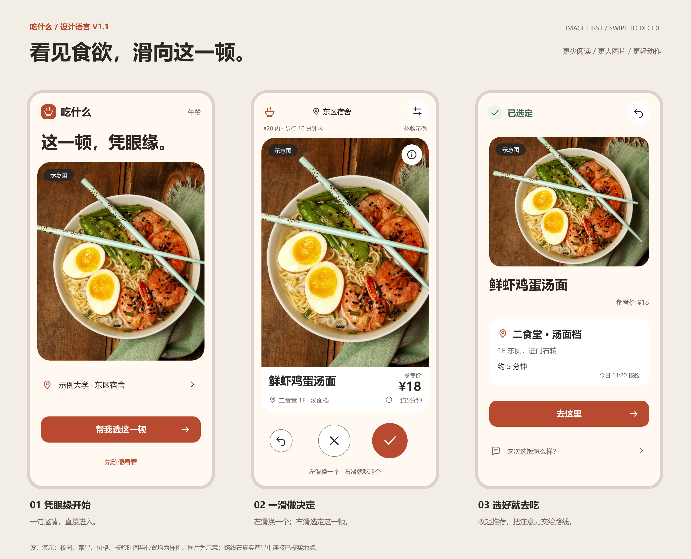

# 吃什么｜设计语言与视觉规范 v1

修订版本：v1.1 · 图片优先与滑动交互  
更新日期：2026 年 9 月 23 日  
依据：当前 PRD，以及“减少文字、符号化控件、左右滑动判断、扩大图片”的最新要求  
用途：产品设计基调、核心原型参考与开发验收依据；沿用原文件名，替代上一版文字较多的推荐卡。

## 1. 设计主张

**看见食欲，滑向这一顿。**

用户先看到一道想吃的菜，用一次轻动作表达判断。界面保持温暖和具体，把大部分视觉空间交给食物，把解释放到需要时再展开的详情里。产品的结束点仍是选好这一顿、知道去哪里吃。

设计优先级：可执行与可信 → 看清食物 → 顺手做判断 → 需要时了解细节。照片负责第一眼的吸引力，价格与位置负责让选择落地。

### 1.1 本次修订的关键变化

| 项目 | 当前设计决定 |
|---|---|
| 推荐页结构 | 大幅竖向图片 + 紧凑事实底栏 + 圆形操作区 |
| 文字密度 | 默认不展示食欲描述、“为什么是它”标题和段落 |
| 左滑 | 换一个，仅跳过当前候选 |
| 右滑 | 就吃这个，进入已选定结果页并结束推荐 |
| 点按替代 | × 换一个、✓ 就吃这个，与手势执行同一业务动作 |
| 详情 | 点 ⓘ 展开理由、核验信息、完整位置、本顿排除与报错 |
| 撤回 | 撤销最近一次跳过；选定后可撤回到刚才那张卡 |
| 图像比例 | 390 × 844 参考视口中，主图由 350 × 245 改为 358 × 492 px |

主图高度由约 29% 提升至约 58% 的视口高度；可见图片矩形面积由约 26% 提升至约 54% 的视口面积，约为原来的 2.05 倍（不扣圆角）。图片占新卡片高度约 84%。这些数值描述参考图，不能为了凑比例挤掉必要事实或操作。

### 1.2 四条设计原则

1. **一眼看到食物。** 不让标题、推荐理由、标签抢占图片主体。
2. **一个动作表达判断。** 卡片随手指移动，松手后才决定；选定就进入结果。
3. **符号有明确含义。** 通用动作采用图标；价格、地点、风险与选项内容仍用必要文字。
4. **决定随时可修正。** 留下撤回和修改条件入口，一次跳过不变成永久不喜欢。

## 2. 核心参考图

| 文件 | 设计用途 |
|---|---|
| [01 入口](design/references/01-entry.png) | 短标题、大图、出发点，以及真实选饭/体验两个入口 |
| [02 推荐卡](design/references/02-recommendation.png) | 图片优先、事实底栏与图标操作；展示首次方向提示 |
| [03 已选定](design/references/03-decided.png) | 减弱图片，突出地点、路线与撤回；反馈退到后面 |
| [04 视觉与动作规范](design/references/04-style-board.png) | 色彩、字阶、图标、密度与状态 |
| [05 滑动与详情](design/references/05-swipe-and-detail.png) | 左右拖动中的意图反馈，以及信息弹层 |
| [06 详情单图](design/references/06-detail.png) | 完整信息与本顿排除入口 |

[集中浏览参考图](design/index.html) · [CSS 变量与组件样式](design/design-tokens.css)

单屏为 390 × 844 CSS px 内容视口，PNG 以 2 倍导出，不包含浏览器地址栏与系统状态栏。SVG 保留可编辑文字。展示板的外框和说明文字不属于产品界面。

所有校园、菜品、价格、核验时间、配料与位置均为演示数据；照片用于菜品示意。图样浏览页属于设计资料，尚未实现手势交互，也没有接入真实供给。

## 3. 视觉语言：温暖底色，照片居中

### 3.1 颜色与形状

| 角色 | 色值 | 用法 |
|---|---|---|
| 页面底色 | #FFF9F2 | 暖白背景 |
| 卡片/图标底 | #FFFFFF | 事实底栏、次按钮、图片上的信息按钮 |
| 主动作 | #B84A30 | ✓ 选定、入口与路线按钮 |
| 品牌点缀 | #E9673F | 少量装饰，不承载小号白字 |
| 主文字 | #2D2723 | 菜名、价格、图标 |
| 次文字 | #746A62 | 地点、时长、必要注释 |
| 浅色强调 | #FBECE3 | 条件选中态、右滑意图反馈的辅助底色 |
| 普通分隔/控件边界 | #E8DFD6 / #927F70 | 非交互分区/可交互描边 |
| 已选定 | #44664D / #EDF2EA | 对勾与文字，只表示已做出选择 |
| 未知提示 | #98502E / #FFF1DE | 状态图标与明确提示文字 |

不叠加闪光、点赞计数、热度贴纸和促销红。左滑属于正常选择，用中性色表达；右滑使用番茄色表达意图，选定完成才出现浅绿确认。

卡片圆角 28 px；入口与结果的图片圆角 24–28 px；按钮圆角 16–18 px；图标按钮为圆形。默认不靠浓重投影强调卡片，拖动时可加轻投影帮助理解浮起状态。

### 3.2 字体与尺寸

使用系统中文黑体，优先系统字体、苹方、微软雅黑或 Noto Sans CJK SC；首版不加载外部中文字体。

| 内容 | 参考字号/行高 | 规则 |
|---|---|---|
| 入口短标题 | 32–36 / 42 px | 一句，最多两行 |
| 推荐菜名 | 24 / 32 px | 600–700 字重；长名允许两行 |
| 结果菜名 | 28 / 38 px | 已选内容清晰可认 |
| 价格数字 | 26 / 32 px | 带“参考价”语境；不做促销视觉 |
| 位置与步行时间 | 13–14 / 20 px | 主卡底栏直接可见 |
| 详情正文 | 16 / 24 px | 普通段落，短句说明 |
| 角标、条件摘要 | 12 / 18 px | 不再缩小；关键信息不使用低对比浅灰 |

普通文字对比度至少 4.5:1；图标与可交互边界至少 3:1。白字/番茄底约 5.17:1，灰褐/暖白约 5.05:1。图片上的文字使用不透明底板，避免靠照片恰好够暗来保证可读性。

### 3.3 图片构图

- 推荐卡采用接近 3:4 的竖向构图，食物主体占画面约 65%–85%，保留适量碗沿、桌面或餐具。
- 优先选择适合竖裁切的素材；为每张图维护焦点，避免切掉主要配料、让碗只剩边缘。
- 光线自然，色彩接近真实食物；单一主体，不拼接九宫格，不叠营销文字。
- 允许真实照片与有吸引力的 AI 示意图。示意图固定保留深底白字“示意图”；AI 图可写“AI 示意”，不得用晦涩图标代替。
- 与已知菜品配料、份量明显不符的图不能作为该菜品的诱导性展示。
- 详情里说明图片性质。真实出品图也不代表实时库存或当前营业。
- 弱网先出现菜名与事实；图片加载失败保留同尺寸占位和“图片暂不可用”，仍可跳过或选定。

参考照片出处见 [素材说明](design/assets/SOURCES.md)。量产素材需替换为有权使用、与菜品对应的资源。

## 4. 信息架构：主卡轻，详情完整

### 4.1 主卡默认直接呈现

| 区域 | 内容 | 克制规则 |
|---|---|---|
| 顶栏 | 出发点、条件图标 | 当前预算和步行范围用一行摘要，避免条件被完全藏起 |
| 图片 | 单一食物主体、示意标识、ⓘ | 不叠描述段落，不盖住食物中心 |
| 事实底栏 | 菜名、参考价、食堂/楼层/档口、约步行时间 | 两层信息；名称过长自然增高 |
| 操作区 | 撤回、×、✓ | 常态以图标为主，首次显示一句方向提示 |
| 例外提示 | 营业待确认、关键事实缺失或与当前禁忌相关的不确定性 | 在选定前直接可见；不能只放详情 |

390 × 844 基准：卡片外边距 16 px，卡片 358 × 588 px，图片高 492 px，事实底栏高 96 px。操作区独立位于卡片下方，不覆盖食物。推荐图中的撤回展示可用态；初次无历史时保留占位并禁用。

已知与明确禁忌冲突的菜品在候选层排除；若关键配料无法核实、不能确认满足硬约束，同样不能用“待确认”代替过滤。这里的风险提示用于仍可展示的信息状态，并非绕过硬约束。

### 4.2 ⓘ 详情弹层

按“理由 → 完整事实 → 配料/图片说明 → 本顿排除 → 信息报错”组织：

- 一句“为什么是它”，只写与当前条件有关的已知事实。
- 完整档口地址、参考价、预计步行时间、事实核验时间与来源。
- 可核验配料及图片性质说明；普通配料信息可在这里展开，需立即提醒的风险仍在主卡显露。
- “这一顿不想吃面”等明确动作，作用范围写清；条件图标也可进入排除面板。
- “信息有误”入口，不要求填写联系方式。

弹层内采用正常文字，方便辨别具体品类、预算和反馈选项；“减少文字”主要服务高频判断页。关闭后回到原卡片，不产生换卡、不重置计时。弹层打开期间，背景卡不可滑动。

### 4.3 入口与结果

入口只保留一句邀请、出发点、大图、主按钮“帮我选这一顿”和“先随便看看”。这两个入口保留文字，以便正确表达使用意图，不合并成一个不明含义的播放符号。上次选择从入口次级历史图标进入，首次无记录时无需显示。

结果页显示已选定、菜品、价格、清楚的位置和“去这里”。右上角撤回返回刚才的卡片；可从菜品详情找到报错。路线不可用时显示文字位置，不跳往虚构坐标。参考图只表达真实产品的布局。

路线之后以“这次选饭怎么样？”展开四个等权反馈选项：更省心、差不多、更费劲、平时不用纠结。默认收起，可跳过，不能预选。餐后反馈继续沿用 PRD 的自愿回访方式。

## 5. 符号化控件

图标基于 24 px 网格、1.8–2 px 圆端描边；用矢量图标而非系统 Emoji，以保持跨设备形态一致。

| 图标 | 业务语义/可访问名称 | 尺寸与说明 |
|---|---|---|
| 回弯箭头 | 撤回上一次跳过 / 撤回这次选定 | 推荐页 48 px；无可撤回动作时禁用 |
| × | 换一个 | 68 px，中性描边，支持直接点按 |
| ✓ | 就吃这个 | 76 px，番茄实底；表示本顿选择 |
| ⓘ | 查看菜品详情 | 44 px 不透明白底，放图片角部 |
| 调节杆 | 修改本顿条件 | 44 px，顶部右侧 |
| 定位点 | 修改出发点 | 与地点一起形成至少 44 px 高的热区 |
| 对话框 | 反馈本次体验 | 结果页的次要动作 |

不使用爱心代表“本顿选定”，以免被理解为收藏或积累喜欢列表。× 在弹层右上角表示关闭，在主卡操作区表示跳过；位置、可访问名称和首次提示共同消除歧义。

图标按钮必须有 aria-label 或等价的可访问名称，鼠标悬停/键盘聚焦可显示短名称，不能只提供 title 属性。焦点采用 2 px 深色外描边，外偏移 3 px。触控无需依靠长按才能理解或执行主要动作。

## 6. 滑动交互规范

### 6.1 方向与行为

| 动作 | 用户意图 | 产品响应 |
|---|---|---|
| 左滑并松手 | 这张先跳过 | 展示下一张满足条件的未展示候选 |
| 右滑并松手 | 这一顿就吃它 | 选定当前项，进入结果页，停止推荐 |
| 拖动距离不足 | 还没决定 | 原卡平稳回位，无业务事件 |
| 方向反转 | 修正正在表达的意图 | 跟随最终方向；过回阈值内则不提交 |
| 点 × / ✓ | 同上 | 与对应手势走同一业务逻辑，不重复确认 |
| 点撤回 | 修正上一动作 | 恢复上一张或取消选定，保留条件与计时 |

左滑不自动排除整类食物、不写永久口味、不判定用户讨厌这张图。需要排除品类时，通过详情或条件面板明确表达。

### 6.2 手势识别与动效

以下是首版可实施的起始参数，后续根据真实误操作反馈小步调整：

1. 触点从卡片非控件区域开始；移动不足 10 px 时视作轻触，不触发滑动。
2. 当横向位移绝对值大于纵向的 1.35 倍，才识别为横向拖动；纵向优先保留页面滚动。
3. 提交阈值为卡宽的 25%，限制在 80–112 px；358 px 卡宽约为 90 px。首版不以速度单独触发提交，快速轻甩仍需满足距离。
4. 拖动过程中位置实时跟手，倾角上限 8°。越过阈值后显示“× 换一个”或“✓ 就吃这个”的清晰浮签；浮签留在视口内，不随卡片被裁掉。
5. 只有松手时仍满足阈值才提交；回到阈值内、pointercancel、切后台或多指中断均回位。
6. 回位约 180 ms；提交退出约 200 ms；下一张淡入约 120 ms。提交期间锁定重复动作，动画结束即恢复可操作。
7. 下一张的结构化信息提前准备，最多预加载一张图片；不等 AI 生成、不使用洗牌或长旋转。右滑后不预告下一张。
8. 页面左右边缘约 20 px 内起手，优先留给浏览器系统返回；卡片拖动不能屏蔽纵向滚动与双指缩放。
9. 减少动态效果开启时，取消倾斜、飞出和弹性动画，用短淡变或即时替换；点按路径完整可用。

手势、图标按钮、键盘/读屏点按等价。首版不强制增加全局左右方向键快捷键，避免与浏览器及辅助技术操作冲突。

### 6.3 首次引导与撤回

第一次显示推荐卡时，在操作区下方保留一句“左滑换一个 · 右滑就吃这个”，不弹教程、不要求练习。完成第一次有效操作后，下一张可收起提示；图标聚焦名称与可访问名称始终保留。取消拖动不算已学会操作。

首版保留最近一步可撤回记录：

- 跳过后，撤回恢复上一项及对应候选队列，恢复本身不计新跳过。
- 选定后，撤回回到刚才已选卡片，不直接换成新菜。
- 不使用几秒后消失的唯一撤回入口。最近一步记录持续到下一次有效决策动作、条件变化或会话结束。
- 修改条件后旧候选可能失效，清空旧撤回记录；打开详情、滚动和浏览路线不清空。
- 撤回不重置 session_id、总计时或已有原始记录，不重复增加认可会话数。

### 6.4 连续跳过与异常

连续跳过 3 次时，允许显示一次不遮挡卡片的“调一下条件？”小入口，点开后再询问原因；无需停下阅读或强制回答。排除、自己选等能力继续保留在条件面板中。

候选耗尽时不循环播放同一批菜：显示“暂时没有更多”，提供撤回、修改条件和结束。加载失败不悄悄跳过当前项；保留当前卡和重试。营业未知或价格异常等必要文字不能为了图像比例被隐藏。

## 7. 尺寸适配与无障碍

- 支持 360–480 px 内容宽度，宽屏仍单列居中；顶部与底部适配 safe-area。
- 基准图不代表所有设备都固定高 844 px。使用可视视口高度，先预留顶部、事实与操作区，再分配图片。
- 普通短屏可把图片高度降到约 280–492 px；更矮视口、两行菜名、风险条或大字号时允许页面纵向滚动。
- 不通过固定总高、隐藏溢出或缩小事实字体实现“一屏装下”。200% 文字放大后优先保留内容与操作。
- 菜名允许换行；实际地点不能用无说明的缩略语代替。次要核验详情可折叠，但不能让信息来源不可找到。
- 弹层可滚动，关闭热区至少 44 px；打开后焦点进入弹层，关闭后回到原触发图标；背景设为不可交互。
- 新卡使用简短 aria-live 提示，避免播报整页或重复抢焦点。结果页聚焦“已选定”；弹层支持 Escape 关闭。
- 图片替代文本描述菜品并说明示意性质；不要把文字烘焙进生产图片。

## 8. 轻量验证的设计影响

本次继续采用 MVP 发布、渠道传播、真实使用与可选反馈，不增加问卷或人工用户实验。

滑动可能增加冲动认可，所以保留 PRD 的首次认可率与 30 秒首次认可口径，同时观察撤回，避免只把右滑次数上升当作效果改善：

| 记录 | 设计与分析要求 |
|---|---|
| 输入方式 | 认可/跳过附 input_method：swipe、button 或 assistive（只有能可靠识别时才写 assistive，否则记 button） |
| 动作标识 | 每次有效动作有 action_id，防止手势与按钮重复提交 |
| 撤回 | 关联原 action_id；跳过撤回记 card_undo，选定撤回记 decision_reopened |
| 快速反悔 | 认可后 10 秒内撤回的动作占比，仅作疑似误操作信号，不断言都是误滑 |
| 最终选定 | 观察已结束会话中仍保留选择的比例，与至少一次认可比例并列 |
| 反馈展示 | 收起的反馈入口不记为题目曝光；实际展开后才记 feedback_shown |

已有首次认可事件保留；撤回不能洗掉失败或重新开启 30 秒计时。报告渠道、产品版本和 swipe/button 样本数；不同操作方式并非随机分组，不能用比例差直接证明滑动更有效。

判断仍依靠真实选饭、自述省心、餐后采纳与跨日复用。设计稿展示的是待验证方案，没有证据表明扩大图片或左右滑动已经提升了这些指标。

## 9. 开发验收与边界

### 9.1 必须保持

- 常态主卡没有长段食欲文案和独立推荐理由块；大图是视觉主体。
- 菜名、参考价、位置、步行时间、示意标识直接可见；关键未知状态不会被折叠。
- 左滑与 × 等价，右滑与 ✓ 等价；选定即结束推荐。
- 未达阈值、纵向滚动、多指与中断不产生认可/跳过；详情按钮不会误触滑动。
- 撤回有效、计时不断、无重复认可；连续快速操作不会跨过多张卡。
- 初次提示、可访问名称、焦点、字号放大和减弱动效都可用。
- 本顿排除、修改条件、报错、自己选与反馈仍有明确入口。

### 9.2 需要在实现中验证

360 px 小屏、短屏、200% 字号、长菜名、弱网/坏图、空候选、营业未知、单步撤回、浏览器侧滑返回、详情内滚动、键盘/读屏、连续点按与拖动取消。静态 PNG 不能证明这些行为已经实现。

### 9.3 文档与实现关系

当前 PRD 管业务规则与验证口径；本说明管视觉层级、图标语义和手势参数。两份既有开发方案中的技术与范围继续适用，其旧式文字按钮与卡片排版描述应按本次设计修订实现。本次没有重写开发架构，也没有制作完整可交互 Demo。

图样由 [生成脚本](design/build_reference.py)、[布局源](design/swipe_layout.py) 和 [导出脚本](design/render.cjs) 生成；CSS 提供实现起点。已经检查当前图样的主要文本宽度、图片导出和整体布局；生产端仍须完成上述交互验收。

